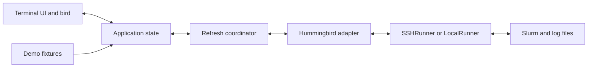

# Perch architecture

Decision record saved October 9, 2026 (America/Los_Angeles).

## Product and implementation status

Perch is a standalone terminal companion for UCSC Hummingbird. It should make personal jobs, arrays, pending reasons, output, and outcomes understandable in a calm keyboard-driven interface. It is independent of any particular course or workload.

This document records the agreed direction and refinements discussed with the user. The development executable implements monitoring, first-connection setup, system SSH, resource charts, workload preparation/submission, allocation-shell and cancellation reviews, keyboard/mouse navigation, saved preferences, diagnostics and optional restart snapshots. CLI queries and a stdio MCP interface share a read-only query service; explicit mutations use separate services. The NRP workspace is a preserved experimental subset, deferred by the user on October 10, 2026 and outside the active Hummingbird release scope. Release readiness remains incomplete; see [current readiness](docs/READINESS.md) and its linked validation history. Requirements below remain authoritative where implementation has not yet caught up.

The user's priority is to build Perch properly. Staging implementation is a dependency order, not a reason to defer essential architecture or reduce the finished product's quality. See [feature design](docs/feature-design.md) for the planned behavior and additional candidates discussed after the initial architecture.

## Stack and process model

- Go executable using Bubble Tea, Lip Gloss, and selected Bubbles components.
- System OpenSSH for remote access, retaining users' SSH config, agents, keys, jump hosts, and known-host checks.
- Hummingbird-specific Slurm adapter with normalized domain types.
- Local config and optional bounded snapshot cache; no database initially.
- No required remote daemon, remote package installation, web backend, or LLM service.
- macOS is the initial client target; a Linux build enables on-cluster operation where permitted.



## Boundaries

| Component | Responsibility |
| --- | --- |
| Launch service | Typed single/multi-node command plans, task and launcher selection, non-submitting validation, explicit one-shot submission and receipts; separate from read-only queries |
| Allocation shell service | Fresh owned attempt/allocation/node checks, explicit review, bounded foreground handoff and return; separate from reading job output |
| Cancellation service | Separate job/task/whole-array scopes, short-lived one-shot review, fresh identity comparison, bounded execution and requested/unconfirmed/unknown receipts |
| Query service | Shared CLI/MCP reads, normalized JSON units, array reconciliation and accounting state |
| MCP server | Typed read-only tools, bounded responses, offline guides and investigation prompt |
| UI | Layout, navigation, command palette, selected-job view, log viewport, connection status |
| Application state | Immutable snapshots, selection, freshness, observed transitions, normalized errors |
| Refresh coordinator | Cadences, deadlines, deduplication, backoff, cancellation, stale-response rejection |
| Hummingbird adapter | Capability probes, command construction, Slurm parsing, field and unit normalization |
| Runner | Execute bounded operations through SSH or directly; capture stdout, stderr, and exit status |
| Bird component | Approved sprite assets, local animation clock, state selection, static fallback |
| Event/insight processing | Reconcile observed transitions, diagnose with evidence, derive warnings and array summaries |
| Notification delivery | User-configured desktop or terminal backend, grouping and deduplication |
| Config/cache | Host alias, preferences and bounded last-known monitoring metadata; no cached logs, scripts, paths or credentials |

Explicit defaults now live in `internal/preferences`: host, warm/graphite theme,
reduced motion and mouse capture. `perch config` is an offline inspection/edit
interface. Invocation flags, including explicit false, override saved values;
`--no-config` bypasses them. Host defaults are shared by remote queries, MCP
startup and launch plans. No notification/local/submission switch is persisted.
Files use schema version 1, a 16 KiB limit, owned private directory/files,
no-follow directory-relative operations, bounded locking, and atomic synced
replacement. Unknown fields, duplicates, malformed content and future versions
fail visibly; reset may replace malformed data but never bypasses file ownership
or type checks. Reads never create state. `/settings` stages appearance changes,
previews palette/motion, and applies or atomically saves them. Escape or tab
navigation restores the prior appearance. Mouse capture changes only on apply;
demo and `--no-config` never persist. The appearance transaction preserves the
latest saved host, including concurrent CLI edits. Animation scheduling tracks
one pending frame timer so rapid pause/resume cannot multiply rendering loops.
`--cache` now enables a separate, display-only last-known snapshot. It is opt-in
per invocation, stores one most-recent destination, and requires matching verified
cluster/user identity before cached job reads can resume. The fallback uses a
separate presentation store; its transitions never feed notification events.
Successful component reads replace cached jobs/history/partitions independently.
All three fresh components retire the fallback. The regular live store and
notification checkpoint remain authoritative for event reconciliation.

`internal/snapshotcache` whitelists bounded job/partition metadata, excluding paths,
steps, scripts, logs, credentials and raw replies. Files expire after 24 hours;
10,000 jobs, 10,000 history rows, 128 partitions and an 8-MiB encoding bound are
whole-view limits. One private data file and one reserved pending file bound
normal and crash-interrupted writes. Directory-relative no-follow operations,
owned 0700/0600 files, single-link regular-file checks, bounded locking, sync and
atomic rename protect the optional store. Errors leave live monitoring usable;
CLI/MCP continue to require live data. Missing-array evidence remains in the
separate notification checkpoint, not this snapshot cache.

Keep the runner interface small. A future cluster plugin framework is outside the initial scope. Parser DTOs stay inside the adapter; UI code uses types such as Job, JobArray, JobStep, Partition, CapabilityReport, and Snapshot.

Reconciled domain events feed notifications, Chip and the `/activity` workspace
view. Activity retains the latest 100 observed events for this process only; it
does not replay initial accounting history or restore cached transitions. Entries
carry the exact AttemptKey for navigation, and observation timestamps are labeled
as local observation time rather than scheduler finish time. A missing/restarted
attempt remains an event without opening a replacement job. Rendering generates
no events or polling. Derived insights retain evidence and uncertainty separately
from authoritative scheduler state.

## Connection modes

Connection modes:

```sh
perch --host hummingbird  # local UI, SSH transport; alias configured by the user
perch --local            # direct Slurm commands in the current environment
perch --demo             # deterministic offline scenarios
```

Modes should initially be explicit. Presence of a Slurm executable is insufficient to identify the intended cluster.

Hummingbird's public guidance broadly prohibits applications on login nodes, while its training identifies job-status checks as a login-node activity. A persistent third-party TUI is not explicitly approved by that wording. Build LocalRunner, retain the Mac-hosted default, and verify the login-node use case with administrators before advertising it as supported. LocalRunner can also operate inside a permitted interactive compute allocation. No administrator contact has been sent.

## SSH lifecycle

Perch should manage its own short, private control-socket path and pass explicit ControlMaster, ControlPath, and ControlPersist settings. Do not take ownership of or terminate an unrelated user SSH master. Keep the socket directory private and account for Unix socket path-length limits.

Background queries use BatchMode=yes, connection/operation deadlines, and bounded output. Authentication-required, host-key failure, network failure, remote-command failure, and parse failure must be distinguishable.

Reconnect is a user action within the TUI. Suspend the UI using Bubble Tea's ExecProcess, allow OpenSSH to authenticate interactively while establishing the reusable connection, and resume with a fresh capability probe and refresh. Reconnection must not strand the user in an unnecessary remote shell. Never collect or store passwords in Perch.

Reconnection cancels and invalidates in-flight cluster requests, but preserves
the workspace notification context and exclusive state-file lock. Those close
only on final shutdown; otherwise a successful sign-in would silently disable
alerts for the rest of the session.

The status row always exposes connection health, even with an active job filter.
Filters share the row; on narrow screens snapshot age yields space before the
connection state or filter. Recovery actions and a short error appear near the
command input, and the Connection panel starts with the full wrapped error.
Transient notices cannot replace connection state and expire after eight seconds.

SSH executes remote command strings through a shell. Local exec argument arrays alone do not prevent remote shell injection. Validate typed job identifiers, centrally quote remote arguments (including metadata-derived paths), use option terminators where supported, and keep job names/log content out of command syntax.

## Data sources and semantics

| View/data | Primary source |
| --- | --- |
| Active jobs, arrays, pending reasons | squeue |
| Completed jobs and exit status | sacct |
| Partitions and node allocations | sinfo |
| Selected live job details | scontrol |
| Running resource measurements | sstat, when supported |
| Output | Bounded reads of stdout/stderr files |
| Optional priority/fairshare detail | sprio and sshare |

Detect supported parser versions and select one explicitly. Hummingbird accepted `squeue --json=v0.0.44` during the recorded check. A future upgrade may remove it: handle unsupported schemas explicitly rather than silently treating failed parsing as an empty queue. Normalize set/unset/infinite wrappers and preserve unknown states/reasons for display.

Track numeric allocation IDs, array parent IDs, array task IDs/ranges, and step IDs separately. Large arrays may be partly collapsed and partly expanded. Do not eagerly expand arbitrarily large pending ranges. Live accounting was verified using the underlying numeric job ID plus `.batch`; the initial array-form query failed.

A job disappearing from squeue is not confirmation of success. Reconcile with sacct, allowing for accounting lag and an explicit unresolved outcome. Do not celebrate historic completed jobs merely because they appear in the first snapshot.

Missing collapsed arrays have a presentation-only summary derived from the gap
between an observed high-water total and the latest reconciled records. This is
a lower-bound count, not task membership. `Store.ArrayGaps` does not add records
to the scheduler snapshot, notification events, or deduplication keys. Its UI
rows carry no task ID, range, allocation ID, resources, or file paths; task
actions are blocked. Actual accounting parents do not count as individual tasks.
Display totals are scoped to array/user/cluster/submission, expire eight days
after the last queue observation, and are bounded to 512 arrays with a visible
coverage notice. Fully confirmed arrays retire their display baseline so an
aging history window cannot resurrect them. The existing opt-in notification
checkpoint saves this small display metadata; the optional monitoring snapshot
stores a separate bounded view and does not restore these notification events.

Capture stdout/stderr patterns and working directory while a job is visible. Hummingbird's controller retention was 120 seconds. sacct also retained stdout patterns for tested completed jobs. Resolve array filename substitutions correctly; blank stderr can mean it shares stdout. Files may still be missing, deleted, inaccessible, or stored outside login-node-visible storage.

GPU allocation counts are not GPU utilization. Start times are scheduler estimates, not promises. A fairshare value is not necessarily an active priority factor: Hummingbird had PriorityWeightFairShare=0 when checked.

Resource values must retain units, scope, freshness, and missing-data status. MaxRSS must not be presented as total multi-task or multi-node job memory without correct aggregation semantics. CPU efficiency can use accounted CPU time divided by allocated CPU wall time, with explicit handling of missing/partial/requeued data. Preserve job/step hierarchy to avoid double counting. seff is a useful diagnostic reference, not a required application dependency.

Accounting normalization keeps requested and allocated memory separate, including
requests for jobs that never started. Recorded RSS scope follows the reported
task marker: a task, node-centric (-1), or unknown scope. Job peaks take the
largest step observation rather than summing unrelated high-water marks.
Interrupted jobs qualify CPU ratios; restarted jobs omit ratios whose accounting
may span different attempts. Both successful live samples and failed-query gaps
share the 90-sample retention limit. See [sacct](https://slurm.schedmd.com/sacct.html)
and [sstat](https://slurm.schedmd.com/sstat.html) for the metric definitions.

## Refresh and rendering

- Initial proposal: personal jobs roughly every 30 seconds while relevant; partitions/history around 60 seconds or longer; explicit manual refresh available.
- Fetch selected-job details on selection and only refresh while useful.
- Batch operations into one SSH invocation when they are due together, with unambiguous response framing and per-operation stdout/stderr/exit status. Do not tie every dataset to the fastest cadence.
- Use one coordinator to prevent duplicate overlapping refreshes. Tag results by connection generation/request scope and discard stale responses.
- Apply backoff on failures, and suppress unnecessary work for inactive views.
- Keep local rendering and bird animation independent from network activity.
- Preserve the last successful snapshot on disconnect and label its age; a failed refresh must not clear the queue.

These intervals are product proposals, not administrator-approved limits. Slurm cautions that client polling burdens the controller. Further constrain requests using user/job filters and only fetch necessary data. In testing, `--only-job-state` rejected combination with `--user`, so it is not a drop-in replacement for user-scoped discovery.

Log reads should be incremental and bounded, handle truncation/rotation, avoid buffering entire files, and stop when the view closes. Sanitize terminal control sequences before display. A single optional log stream must not block scheduled status queries.

## Interface and approved artwork

Visual references: Superfile's panel structure and focus treatment; Claude Code's quiet command area, progressive detail, and readable activity feedback. Wide layouts use navigation, jobs, and details; narrow layouts make details a separate view.

**Design correction, October 9:** Follow the original mockup's prominent title bar and persistent Claude Code-inspired command input at the bottom. The initial left navigation column was superseded by the user's top-tab choice recorded below. The user explicitly rejected a large decorative bird panel. Chip should be a compact status accent; do not allocate a full sidebar to the mascot. Slash commands and job-ID navigation must work, with keyboard completion and clear focus. The job-specific action card temporarily hides the inactive command input at compact sizes; Escape restores it.

The mascot is named **Chip**; the application is **Perch**. The user explicitly selected the **round second-pass bird set** after comparing later variants. The canonical assets are in `assets/bird/`. Later slim/flight studies are not the approved design. Preserve the approved set unless a future request changes that decision.

States: idle, running, queued, complete, attention, reconnecting. The global bird should reflect connection/overall workload state; individual rows retain their own status labels. Connection loss takes precedence. Exact priority between simultaneous running, queued, and failed jobs should be explicit and tested. Completion is a one-shot observed transition; preview GIFs intentionally loop it for review.

Use terminal color capability detection, an animation toggle/static fallback, and text labels alongside color. The existing 32x32 half-block renderer occupies 32 columns by 16 rows and must not appear as a decorative workspace sidebar. Keep the approved source artwork; a compact status rendition needs separate visual validation before insertion. Browser PNG/GIF previews do not establish terminal rendering quality.

## Persistence and diagnostics

Start with a small config file and optional bounded, atomically written cache. Respect platform config/cache conventions. Cache freshness and identity must include cluster/user context. Treat job paths, names, and output as user data; avoid caching full logs by default. No credentials in config, cache, or diagnostic output.

CapabilityReport should distinguish supported, unsupported, permission denied, temporary failure, and unverified. Hide or explain unavailable measurements instead of filling in zeroes. Expose useful diagnostic information without forcing users to understand implementation details in the ordinary workflow.

Expose the same bounded startup probes through `perch doctor`; this should explain missing capabilities and support troubleshooting without repeating expensive probes on each UI refresh. Supporting more Slurm clusters still requires testing authentication, schemas, policy, storage, and accounting differences.

`--debug` records operation metadata, timing, requested parser/application version,
exit status and classified errors through `internal/diagnostics.Runner`. Arbitrary
error strings, identifiers, argv, paths, stdin and response content are omitted.
`--debug-raw` additionally permits bounded JSON scheduler response capture;
script/log retrieval and submission stdin/output remain excluded. Raw responses
can contain private metadata, including embedded job commands. Neither mode
intercepts interactive login. The wrapper forwards both `RunInput` and
`LoginCommand`, preserving submission and reconnect behavior.

Metadata/raw directories are separate beneath the platform cache directory.
Each has two 2-MiB JSONL files, rotated under a bounded advisory lock. Owned,
private, regular single-link files are opened relative to a no-follow directory
handle. Raw output is base64 encoded and capped at 256 KiB combined per response,
with truncation and original lengths explicit. Capture failure is latched and
reported without changing execution results; in particular, accepted submissions
remain accepted. Initialization errors stop before network/submission actions.
Malformed SSH framing yields classified metadata only because the underlying
runner discards that response. Captures are not automatically safe to publish or
suitable as committed test fixtures. General snapshot caching remains separate.

## Charts and motion libraries

Design chart and motion components as presentation concerns fed by normalized data. ntcharts v0.5.2 now renders resource charts through a view-only adapter in internal/ui/charts.go. Its Bubble Tea v1 Update/Init methods are never used; the application remains owned by Bubble Tea v2. Gaps and missing samples are tested. Harmonica is a candidate for specific spring-based interface transitions. Chip's approved frame animation uses a frame player and does not require procedural physics. Keep metric values and time-series samples faithful to measurements, preserve gaps, and respect reduced motion. ntcharts is pinned. Harmonica remains a candidate for a transition that benefits from spring motion; it is not needed for the current immediate keyboard interactions.

## First implementation milestone

Connect → see personal jobs and arrays → inspect one → read its logs → survive a disconnect → reconnect within the TUI.

Include `--demo` from the start. Use scrubbed real Hummingbird responses for parser fixtures and deterministic scripted scenarios for transitions: mixed arrays, failures, late accounting, empty queues, disconnects, partial command errors, and missing metrics. Scrub usernames, home paths, job names/commands, account identifiers, and log contents as appropriate before committing fixtures.

Test parser normalization, job/array/step identity, exit-state reconciliation, request ordering, quoting, log sanitization, reconnect terminal restoration, narrow layouts, and reduced motion. Verify the full workflow against Hummingbird after fixture tests pass. The first milestone focused on monitoring; the user's later request to move beyond monitoring expanded the implemented scope to submission, shells and cancellation with separate explicit review paths.

## Proposed repository layout

```text
cmd/perch/             CLI entry point
internal/app/          State and coordinator
internal/ui/           Views, keyboard interaction, bird renderer
internal/hummingbird/  Slurm adapter, DTOs, parsers, capabilities
internal/transport/    SSHRunner and LocalRunner
internal/config/       Preferences and cache
internal/demo/         Offline scenarios
testdata/              Scrubbed response fixtures
assets/bird/           Approved second-pass sprites and previews
docs/                  Verified findings and development notes
tools/                 Artwork tooling
```

The main packages, persistence, notification reconciliation and diagnostics now
exist. Native notification delivery and the remaining final acceptance gates are
still open; see the current readiness audit for evidence and precise limits.

## Distribution

Plan for a single executable with versioned GitHub releases and a project-owned Homebrew tap. Official Homebrew inclusion is optional and has separate acceptance requirements. Choose a license and test supported operating systems/architectures before release. No publishing is authorized or performed by saving this document.

## References

- [Bubble Tea](https://github.com/charmbracelet/bubbletea)
- [ExecProcess](https://pkg.go.dev/charm.land/bubbletea/v2#ExecProcess)
- [OpenSSH configuration](https://man.openbsd.org/ssh_config)
- [squeue and polling guidance](https://slurm.schedmd.com/squeue.html)
- [sacct fields](https://slurm.schedmd.com/sacct.html)
- [sstat](https://slurm.schedmd.com/sstat.html)
- [Hummingbird policies](https://hummingbird.ucsc.edu/getting-started/draft-ucsc-shared-hpc-policies-and-guidelines/)
- [Hummingbird Slurm training](https://bpb-us-e1.wpmucdn.com/sites.ucsc.edu/dist/2/1143/files/2021/04/HB-Slurm-101-presentation-Joshs-part.pdf)
- [Homebrew taps](https://docs.brew.sh/How-to-Create-and-Maintain-a-Tap)

### Selected visual palette

After reviewing warm and graphite versions of the same working layout, the user selected **warm charcoal** on October 9. Keep warm charcoal, cream text and peach accents as the default. Graphite is an optional theme. The palette choice does not imply approval of the complete layout; subsequent design refinements should be reviewed interactively with the user.

### Provisional typography decision

The user chose **Ioskeley Mono for now** after reviewing font specimens and Xanh Mono. Use Ioskeley in subsequent design previews, preserve the warm palette, and move on to layout/information density. The wordmark remains undecided; do not continue iterating on it until revisited with the user. This is a font recommendation for the terminal, not an application-controlled font setting.

### Layout trial: top tabs

The user requested trying top tabs next. Keep Jobs, History, Partitions and Connection above the content at every supported width, with workload counts on the right when there is room. Remove the wide navigation sidebar and give that width back to the jobs list and inspector. This is a reviewable trial, not final visual acceptance. Preserve Ioskeley previews, the warm palette, and the persistent command input.

## Delayed array outcome evidence

The store retains compact arithmetic progressions observed in collapsed queue
ranges independently of the visible snapshot. An empty successful queue poll
cannot erase notification eligibility before accounting produces task records.
Membership is scoped by array ID, user, cluster, submission time and restart
count. It is neither a task count nor a terminal state. Compatible progressions
merge and contained ranges are removed without rounding over unobserved indices.
This avoids per-task expansion even for very large ranges.

Notification checkpoints include a deep-copied range ledger. Older checkpoints
seed it from their active collapsed ranges. Evidence expires after eight days
without a queue observation of that attempt. Bounds are 512 attempts, 8,192 total
segments and 1,024 segments per attempt; rejected observations leave existing
evidence intact and surface limited alert coverage in Connection. Checkpoint
validation rejects invalid steps, oversized ledgers and future observation times.
The existing outcome keys still deduplicate grouped notifications across restarts.
This does not turn missing arrays into completed jobs or invent task outcomes.

Confirmed task indices are subtracted from the retained ranges in sorted batches.
This prevents a resolved task from notifying again when its older deduplication
key falls out of the bounded checkpoint. Excessively fragmented unresolved
ranges are retired with the same visible coverage limitation, rather than
expanding memory without bound or retaining resolved tasks as eligible.

## Explicit workload launch (October 10)

`perch run` now previews by default. `--check` validates via `sbatch --test-only`; `--submit` explicitly validates and submits once. `internal/launch` owns typed resource/command plans, validation and receipts. The script is streamed through bounded stdin using SSH or local transport, without remote script staging. Inputs are never uploaded implicitly. The runner remains general, while the read-only query/MCP layer exposes no mutation path. Hidden `SBATCH_*` variables are removed in the submission shell; requested resources are passed as explicit argv. A unique scheduler comment accompanies each submission. An ambiguous transport or response failure is not retried, and the error points to queue/accounting reconciliation. CLI acceptance is distinguished from execution/completion.

**Durable recovery records:** Production CLI/TUI submission configures a private
local `launch.Journal`. It synchronously persists token/destination/name/time
before the mutating call, then records any accepted ID/cluster. An accepted reply
remains accepted in UI/CLI even when its final local save fails. Final persistence
gets a separate bounded context so a network deadline cannot suppress an already
received ID. Unconfirmed records are not job outcomes and are never automatically
resubmitted or evicted. `/receipts` and `perch receipts` read these records offline;
they do not reconcile tokens against Slurm or treat saved destinations as verified
permanent user/cluster identities. No workload commands, scripts, paths or logs
are stored.

The journal is limited to 1 MiB and 1,000 records. At capacity it removes the oldest
accepted record; all-unconfirmed capacity blocks new submission. Transactions use
an owned 0700 directory descriptor, owned 0600 regular files, no-follow opens,
an exclusive advisory lock with a two-second deadline, atomic rename and file plus
directory sync. A single private staging filename under the lock bounds crash
residue. Invalid/corrupt state is reported instead of overwritten. No lock spans
SSH. UI work happens through cancellable commands, with stale reply rejection.

The shared CLI/TUI launch service supports node/task layouts, optional GPUs and ordered modules, separate private output/error files, arrays and successful-job dependencies. The TUI uses the same plan/check/submit service with an explicit review and validation gate. It does not upload application inputs, compile them automatically, or infer MPI/GPU compatibility.


**Notification tracking, October 10:** `--notify desktop` explicitly enables the macOS AppleScript delivery bridge for a live TUI. Reconciled events feed both Chip and notifications; array tasks are grouped, with at most three banners per refresh (larger bursts become one summary). The `internal/notify` package owns a private, atomically replaced checkpoint and an exclusive per-destination/user/cluster lock. Checkpoints retain only bounded observed-job identity and deduplication keys, with eight-day retention; restored observations remain UNKNOWN until refreshed. Saving precedes delivery, providing at-most-once attempts rather than guaranteed delivery. Errors suppress or report alerts without breaking monitoring. No notification settings are changed, no background agent runs, and no actual desktop alert has been sent during automated testing. Native macOS banner/permission acceptance remains outstanding.


**Arrays and dependencies, October 10:** The shared launch spec supports bounded array expressions and successful-job dependencies. One parser normalizes task indices, rejects overlapping tasks and computes exact counts/concurrency for CLI and TUI review; each array element gets the full requested allocation, with aggregate concurrent request ceilings displayed. Array output uses `%A_%a`. Dependencies are explicit afterok conjunctions and add `--kill-on-invalid-dep=yes`, preventing permanently impossible pending jobs. Both use the existing validation/one-shot submission gates. Parent array receipts focus an observed member; subsequent tab/row navigation clears delayed launch focus. Doctor now reports the live MaxArraySize capability.

**Topology and launchers, October 10:** `Spec` records nodes, tasks per node and a resolved launcher. CPU requests are per process; memory and GPUs are per node. Zero topology fields preserve older internal callers' single-task defaults, while CLI/form inputs reject explicit zero. `auto` resolves to direct execution for one task or `srun --mpi=none --kill-on-bad-exit=1` for multiple independent tasks. Explicit `mpirun` uses Open MPI's `ppr:T:node:PE=C` mapping and core binding; users supply compatible ordered modules and an existing program. All command arguments retain literal quoting. Resource review multiplies node/task requests and array concurrency with checked memory arithmetic. Live jobs 801973 (two independent tasks), 801976 (compute-node compilation), and 801981 (two-node MPI_Allreduce) completed successfully. This establishes the small tested topology, not arbitrary distributed application or GPU placement compatibility. Additional platform actions remain separate work.


**Accounting coverage correction, October 10:** `sacct`'s default eligible-job selection can omit dependency-cancelled jobs that never became eligible. Both capability probing and normal history refresh now request all documented Slurm base states explicitly, with existing one-/seven-day bounds. Live `--state=all` is unsupported, so the query uses the explicit base-state list. Never-started records can carry NO_VAL32 in raw timestamp fields; normalization must not expose that sentinel as a future date. The cancellation fixture and live failed-dependency workflow cover this path.

## Queue-wait observations

`query.Waits` derives a personal seven-day start cohort from parsed accounting,
without sampling the cluster globally. It excludes restarted jobs, duplicate
attempt identities, aggregate array records, unstarted jobs, malformed chronology
and starts outside the window. Eligibility has a separate sample count; absent
or invalid eligibility never becomes zero. Array tasks count individually and
are exposed explicitly. Median and nearest-rank P90 are observations only.

CLI `waits` and MCP `perch_waits` use the shared read-only service and fail if
accounting is unavailable, even when queue data succeeds. A queue error alone
does not invalidate accounting. The TUI `/waits` reuses `Store.History`, caches
statistics by the successful `HistoryAt` timestamp and uses the existing
coordinator cadence. It displays snapshot time and an age notice after two
minutes; no new timer, SSH command or background polling loop was introduced.

## Attempt-aware reconciliation

`Job.AttemptAfter` is a partial order within the same cluster/user/displayed ID:
known submit times distinguish submissions; restart count breaks equal-submit
ties. Missing times or differing scope do not prove one record supersedes the
other. Store and point queries use this comparison instead of accounting order.
Current queue observations remain authoritative. An observed active attempt
cannot be replaced by an older accounting outcome after disappearing; it stays
UNKNOWN until the matching or demonstrably newer attempt appears. Confirmed
terminal outcomes do not regress to older attempts or stale nonterminal rows,
but still age out when the accounting window no longer contains that ID.

Selection refresh compares attempt keys as well as displayed IDs. An attempt
change invalidates in-flight detail replies, log cursors/content and live chart
samples. The existing sequence guard rejects late responses from the old
attempt. `restart_count` is exposed in the shared query DTO and nonzero counts
are visible in human inspectors.

Array summaries omit older task outcomes covered by a newer pending range or
retained newer array observations, without removing those records from History.
This also governs retained minimum totals and missing-task presentation. CLI/MCP
array queries now use the same Store summary as the TUI. Membership tests retain
compact ranges, including large arrays; no per-task range expansion was added.
Conflicting/ambiguous accounting identities remain a readiness gate; the
mixed-submission requeue evidence and correction are described below.

The accounting parser rejects a response containing different terminal states
for the same cluster/user/displayed-ID/submission/restart key. It returns no
partial history, so response order cannot choose success versus failure in the
store, CLI or MCP. Queue and partition results remain independent; the connection
probe labels this as an invalid response, not an unsupported capability. Exact
duplicates, different submissions and retries remain accepted. The parser also
rejects different allocation IDs for one scoped logical attempt, and duplicate
logical IDs mixing known and missing submission times: those records cannot be
ordered reliably. A single record with missing submission time, or otherwise
identical duplicates with that missing time, remains valid and retains the unknown
timestamp. These guards do not resolve conflicting overlapping range records,
which still need separate reconciliation evidence.

### Collapsed accounting bitmaps and mixed requeues

The v0.0.44 adapter now normalizes hexadecimal `array.task` bitmaps to compact
contiguous ranges and removes the queue's `%N` throttle from range identity.
Input bitmap and normalized text each have a 1 MiB bound; malformed or oversized
representations fail the accounting query explicitly. Accounting requests include
`--duplicates`, still scoped to the current user and bounded time window, so
requeue predecessors remain available to the reconciliation layer.

Nonterminal accounting ranges are coverage evidence, not additional jobs beside
the current queue's tasks/ranges. Their count contributes a retained lower bound;
missing members become awaiting-accounting rows. This prevents stale pending
bitmaps from doubling active task counts during a queue split.

An array display can retain up to 128 admitted submit/restart pairs. A changed
submission time is connected only through an older record of the same scoped
array member, raw job ID, and increasing restart count. Evidence comes from the
previous snapshot or duplicate accounting records, including cold starts. The
original array total and completed siblings survive individual requeues; the
admitted identities are copied and validated in private checkpoints. Exhausting
the bound reports limited coverage and preserves the original minimum rather
than silently resetting it. This is evidence-based continuity, not an immutable
Slurm submission UUID: the selected schema does not supply one in these records.
Array summaries now give records from the most recent successful queue snapshot
precedence over intersecting accounting ranges, including equal-attempt ranges.
The store sets and clears `QueueObserved` on reconciliation; failed queue reads
retain the stale snapshot. A successful empty queue releases precedence only
when accounting is refreshed too. With retained accounting, previously unfinished
identities that overlap cached terminal evidence become UNKNOWN and carry
`AwaitingAccounting`; current queue records still outrank them, and they outrank
cached outcomes. This applies to individual jobs, collapsed ranges and expanded
accounting tasks. The next successful accounting read removes this temporary
precedence. Disappearance alone cannot change progress, copied failure membership,
notifications or the unresolved observation ledger into a confirmed outcome.
The optional display cache retains this metadata without granting read/action
authority. Failed-task copies include only the accounting remainder after current
queue membership is removed, using bounded progression arithmetic rather than
expanding tasks.

Terminal accounting ranges with the same scoped submission/restart evidence but
different outcomes are checked for exact intersection. A conflict makes the array
summary unavailable and disables failed-task copying. Different attempts and
disjoint stepped memberships remain valid. The comparison is bounded by fragments
and work and deduplicates identical observations. Individual records retain their
documented precedence over aggregate ranges. Before ordering attempts, scoped
array membership is checked for overlapping known/missing submission times,
including concrete tasks and ranges with different displayed IDs. Missing times
cannot establish an older attempt. Accounting rejects such an ambiguous component;
combined queue/accounting summaries also refuse it before display-family filters
can hide the conflicting row. Disjoint membership and fully known retries remain
valid. Checks use compact strides with fragment/work bounds. An identity conflict
cannot retire an observed array minimum or generate an aggregate outcome event.

Aggregate outcome events use the same disjoint membership projection as progress
and failed-task copying. Only the intersection with previously observed unresolved
members can notify. That intersection is removed from the bounded checkpointed
observation ledger, preventing later expanded accounting rows from notifying again.
Successive subsets of one scheduler range may produce separate events; each keeps
the original record's attempt identity and carries the confirmed task count.
Activity and grouped banners display that count rather than treating one range as
one task. An accounting range requires a successful accounting read in the same
refresh; losing queue membership alone cannot emit from retained older history.
Contradictory summaries do not generate aggregate outcome events; a later
consistent read can still confirm the retained observation. Work/fragment limits
retain the unresolved ledger and mark tracking as limited instead of partially
emitting. Legacy whole-range outcome keys suppress replay after an upgrade.

### Summary versus full inspector

`glance` owns the sidebar's explicit row budget and always reserves its last row
for inspector entry. Status and array progress precede optional resource fields;
a short terminal uses a compact progress/count line. The same workspace geometry
positions the mouse target, and disabled mouse capture suppresses the click hint.
The full inspector retains all details in the existing viewport, wrapping long
values and suppressing decorative spacers/rules at narrow widths. This avoids
using clipped full-detail output as a summary while keeping navigation and
selection in the existing model.

### NRP stretch-goal boundary

The [NRP assessment](docs/NRP.md) documents the separate Kubernetes adapter and
workspace, authentication prerequisites, semantic differences and acceptance
gates. `perch nrp ui` and the separate NRP query commands select an experimental
read-only subset. It has its own Kubernetes types and does not pretend to be a
Slurm backend. Live access, metrics and workload actions remain open; quota reads now have
synthetic CLI/HTTPS/PTY coverage, with live RBAC acceptance still open;
a generic plugin framework is not assumed or required.


### NRP parser boundary (implemented, offline)

`internal/nautilus` holds Kubernetes-specific Job/Pod/container models and bounded
list-page parsers. It does not implement the Hummingbird `query.Backend`.
Ref identity is cluster + namespace + kind + UID, with name retained for display;
Pods join a Job by matching controller UID and scope. Container previous state
and restarts never decide the enclosing Job outcome. Only Complete/Failed Job
conditions establish terminality; success/failure targets remain in progress.
Missing values stay missing, and indexed ranges stay compact.

Each parsed page retains its opaque resource version and continuation token. The
list client exhausts pagination before returning a complete successful snapshot.
Rejected/partial pages return an error with no collection; the future UI store
must preserve its previously shown data and mark it stale. Parser
limits are 8 MiB, 10,000 objects per page and 64 JSON nesting levels. Unknown
fields are tolerated, duplicate JSON keys and inconsistent required fields are
errors, and errors do not echo raw API payloads. Experimental CLI queries now
load one explicit context through kubectl config view, with exec credentials
only through explicitly requested foreground login. See `docs/NRP.md` for
remaining acceptance gates.


The NRP list client owns immutable cluster/namespace scope and delegates to a
`PageReader` connection boundary. Requests have allowlisted namespaced paths,
250-item pages and opaque encoded continuation values. Each resource list is
bounded at 20 seconds, 32 MiB, 20,000 objects and 100 pages; tokens are at most
16 KiB. No in-place retry can combine an expired list with a newer snapshot.
Jobs, Pods and ResourceQuotas refresh independently and expose distinct success/error results,
resource versions and observation timestamps. Raw server/plugin errors never
enter those result messages. The injected reader must implement cancellation,
output limits and noninteractive credential behavior. `HTTPSReader` now supplies
that production transport using an immutable credential snapshot and a dedicated
HTTP client. It binds cluster and namespace, verifies TLS, rejects redirects,
bounds headers/body/time, and cancels in-flight reads on close. No exec plugin,
browser launch, credential renewal or global-context mutation exists in its read
path. The CLI now wires this to selected static kubeconfig credentials. An
explicit exec-plugin credential acquisition path is now available through CLI
`--login`. Real OIDC/reconnect acceptance and the workspace UI remain open.
Local TLS-server tests exercise actual requests;
they do not establish NRP access or visible UI stale-state acceptance.


### Exact collapsed-array membership counts

`domain.RangeCount` counts the union of compact arithmetic progressions within
one collapsed range expression. Duplicate/overlapping indices contribute once,
including overlaps with different strides. Disjoint bounds are processed as
separate groups; overlapping groups use exact signed intersections, with integer
CRT arithmetic that cannot overflow when strides have a large least common
multiple. No array is expanded into per-task records. The notification membership
ledger remains independently bounded and is not used as an additive count.

Input is capped at 1 MiB. Overlap work is capped at 200,000 term visits and 8,192
retained terms, with checked coefficients and exact intermediate summation.
Exceeding a bound is an error, never an approximation. Task indices exclude
Slurm's reserved uint32 sentinels; brackets, strides and positive concurrency
suffixes are validated before the queue adapter removes formatting/throttling
from membership identity. Parser failure preserves refresh error handling.
An invalid internal range contributes zero rather than an invented single task.
This fixes membership within a record; conflicting records and ambiguous attempt
identity still require separate reconciliation evidence.


### Release candidates and runtime evidence

`tools/release.sh` builds four static single-binary candidates through temporary
staging. Archives include linked documentation, the MCP example and original
Chip artwork, with portable checksum paths and no macOS metadata sidecars.
`make release-check` checks their structure, checksums, executable bits, links
and asset fidelity. The portable runtime harness accepts an extracted binary
and emits its actual architecture and SHA-256 alongside offline CLI, MCP and
PTY lifecycle results. Its temporary home prevents saved user settings from
influencing acceptance. Pixel rendering and native fonts remain outside that
harness. Emulated, native and live-cluster observations are recorded separately
in the readiness audit; passing one cannot imply the others. Project licensing
and third-party notice review are still required before public distribution.


### Experimental Nautilus command boundary

`perch nrp jobs|job|pods|pod` is separate from the Slurm query/MCP contracts.
Each live query requires context and namespace; the saved Hummingbird host and
Kubernetes default namespace cannot redirect it. Configuration loading uses only
bounded `kubectl config view --minify --flatten --raw`, never a cluster command
that could implicitly run a credential plugin. The selected context/cluster/user
references are checked before building the direct HTTPS reader. Unknown auth or
connection settings fail explicitly. Exec credentials require a separately
requested foreground login; background readers have no credential callback.

Demo data is embedded and never invokes configuration loading or networking.
Versioned JSON includes scope, source, observation time and resource version;
Job controller state, Pod counts, compact completion indexes and container
current/previous state remain distinct. Plain output prioritizes scheduling and
current container issues without promoting an old OOM into a current failure.
The implementation is a query subset, not complete NRP support or a durable
history service. `make nrp-test` exercises the built binary, a local TLS API and
synthetic kubeconfigs, including installed kubectl's plugin-free config path.


**Configurable time warnings, October 10:** `internal/timewarning` owns one
validated immutable policy shared by the event store, job highlights and workspace
preferences. Default 5m; one to five whole-minute thresholds (1m–24h), or off.
Each threshold requires a finite job limit at least twice its duration. `/warnings`
offers session Apply and explicit Save defaults; `--time-warnings` overrides saved
configuration. Desktop opt-in remains separate and is not saved.

Only fresh successful queue measurements can create warning events; rendering
and local clocks do not extrapolate elapsed time. Catch-up emits the most urgent
new threshold per job, marks all crossed thresholds seen and records actual
remaining time in the event. Attempt/limit identity isolates retries and changed
limits. Runtime edits baseline currently crossed thresholds. The notification
checkpoint records policy and compacts redundant warning keys to the most urgent
one; older default keys retain their five-minute meaning. A restored checkpoint
under a changed policy baselines warnings on the first successful queue refresh,
without suppressing confirmed outcome catch-up. A 5,000-job/five-threshold test
covers bounded checkpoint deduplication across restart.


## On-demand priority report

`Client.Priority` reads an explicit pipe-delimited `sprio` format, scoped to the
identified remote user and local cluster. The adapter bounds bytes/rows, validates
identity and numeric factors, preserves the scheduler total, and rejects malformed
or foreign rows. TRES factors retain names; Nice remains separate. No recurring
refresh query is added. The shared read-only service exposes CLI `priority`, MCP
`perch_priority`, and TUI `/priority`. A missing backend capability is an error.

The report labels scores as distinct from queue positions. Held or newly submitted
jobs may be absent; zero factors do not establish disabled configuration. Array
allocation IDs and partition-specific rows remain separate. Global reports retain
the calling tab/filter/selection and reject job actions against the hidden list.
This return behavior also applies to software/module reports. A module opened
from the selectable software catalog first returns to that catalog's query,
highlighted name and observation time without another remote read. A second
Escape returns to the calling list, not a nested inspector's scroll position.
Direct module commands with no catalog origin return to the caller immediately.
Refresh restores a still-present module by name rather than by row number;
late results cannot replace a restored catalog. Catalog search is separate from
the retained job filter, which is hidden while these reports are visible.


## Per-node allocation report

`Client.Nodes` calls local `scontrol --json=v0.0.44 show nodes` on demand. The
adapter bounds input at 8 MiB/10,000 rows, rejects malformed schemas, duplicate
identities, negative raw quantities and overflow, and retains nullable counters.
Memory units convert from MiB to bytes. Derived unallocated memory requires all
three configured/allocated/system-reserved inputs and is not clamped to zero.
An unrepresentable derived value stays unavailable. OS free memory is not used.
Node state flags, partition memberships and sanitized GRES text remain visible.
Shared partition membership never multiplies records. CLI/MCP/TUI share this
read-only service; normal refresh gains no extra controller query.

Full-height node and priority reports permit wheel input on the first content
row. All software/global report observations carry their own timestamp so queue
refresh cannot relabel an old report as newly read. Failures remain explicit.
