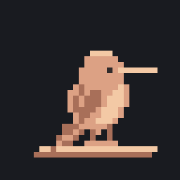
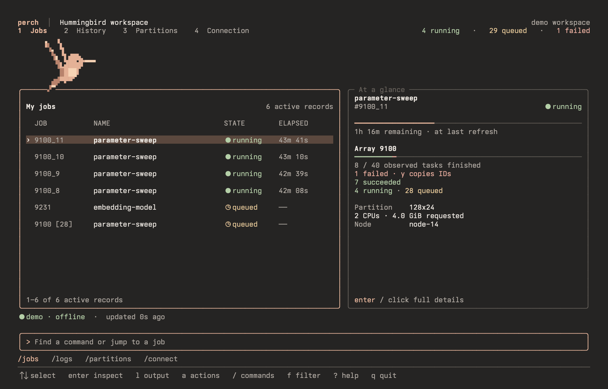

<p align="center">
  
</p>
<h1 align="center">Perch</h1>
<p align="center">A calmer way to work on Hummingbird.</p>
<p align="center">
  <a href="#get-started">Get started</a> ·
  <a href="docs/GUIDE.md">User guide</a> ·
  <a href="docs/MCP.md">MCP</a> ·
  <a href="docs/READINESS.md">Release status</a>
</p>



Perch brings UCSC Hummingbird into one terminal workspace: prepare a workload,
follow its progress, read its output, and open a shell inside its allocation.
It runs on your Mac or Linux machine and connects through your existing SSH setup.
Nothing needs to be installed on the cluster.

- **See what matters.** Jobs, arrays, queue reasons, resource charts and failure hints.
- **Stay in your flow.** Keyboard navigation, clickable controls, searchable commands
  and a job action menu. Inspect, read logs, and return to where you were.
- **Go from idea to job.** Preview scripts and resources, validate, then explicitly
  submit. Prepare arrays, dependencies and multi-node workloads from the same place.
- **Keep the facts straight.** Missing accounting stays unresolved. Allocation
  is distinguished from utilization. Shell and cancellation actions get a review.
- **Bring your tools.** Structured CLI output and a read-only MCP server share the
  same Hummingbird queries and guidance.

And there’s **Chip**: a small animated companion who runs, waits, dozes and celebrates
alongside your work. Turn on reduced motion whenever you prefer.

## Get started

Requires **Go 1.27.2+** to build, and OpenSSH to connect. Clone this private repository
with an authorized GitHub account, then:

```sh
git clone git@github.com:darthnithin/perch.git
cd perch
make build
./bin/perch --demo --no-config
```

The demo is offline. Explore with arrows or clicks, press **Enter** to inspect,
**a** for job actions, **Ctrl+k** to find a command, and **?** for help.
Use **Esc** to leave a panel or input, then **q** to quit.

When you’re ready, connect with your CruzID or an SSH config alias:

```sh
./bin/perch --host your-cruzid@hb.ucsc.edu
```

Press **c** when sign-in is needed; your system SSH client handles authentication.
Run `./bin/perch setup` to save a destination for future sessions.
Hummingbird account access and any required network access must already work.

**Have a preview archive?** Extract it and use `./perch` instead of `./bin/perch`.
The prebuilt executable needs neither Go nor Python. This is a private development
preview; see [readiness](docs/READINESS.md) for the exact tested scope.

## Make it feel at home

Our reference setup is **Ioskeley Mono, 12 pt, 0.90 line spacing**, with warm
charcoal, cream and peach. The terminal controls the font; Perch leaves it alone.

[Get the Terminal.app profile](docs/terminal/Perch-Ioskeley.terminal) ·
[Font and profile setup](docs/terminal/README.md)

Install Ioskeley first, then open the profile. Chip uses Unicode block mosaics;
other fonts can introduce gaps or fallback glyphs. The profile opens a normal
shell and does not change your default profile or run commands automatically.
Use `/settings` for theme, motion and mouse preferences.

## Beyond the workspace

```sh
# Read-only CLI queries; JSON for scripts.
./bin/perch jobs --host your-cruzid@hb.ucsc.edu --json
./bin/perch history --host your-cruzid@hb.ucsc.edu --json
./bin/perch doctor --host your-cruzid@hb.ucsc.edu

# Agent tools and Hummingbird guidance over stdio.
./bin/perch mcp --host your-cruzid@hb.ucsc.edu
```

The [user guide](docs/GUIDE.md) covers workload preparation, logs, scripts,
notifications, arrays and preferences. See [allocation shells](docs/ALLOCATION-SHELL.md),
[cancellation](docs/CANCELLATION.md), and [MCP setup](docs/MCP.md) for those workflows.

## Develop & release

```sh
make check                       # Go race tests, vet, formatting
python3 -m venv .venv
.venv/bin/pip install -r tools/requirements.txt
make terminal-test chip-test mcp-test
VERSION=dev make release-check   # Four local archives; publishes nothing
```

[Architecture](ARCHITECTURE.md) · [Release checklist](docs/RELEASING.md) ·
[Validation history](docs/VALIDATION-HISTORY.md) · [Chip artwork](assets/bird/README.md)

The workspace preview is a looping capture of the real offline demo, rendered
with Ioskeley at 12 pt and 0.90 line spacing through macOS CoreText.
[View the still image](docs/media/workspace.png). Native appearance depends on your terminal. Hummingbird is the active
product scope; existing [NRP experiments](docs/NRP.md) are preserved but deferred.

Private preview. A public project/artwork license has not been selected.
Dependency licenses and notices are included in [third-party notices](THIRD_PARTY_NOTICES.md).
